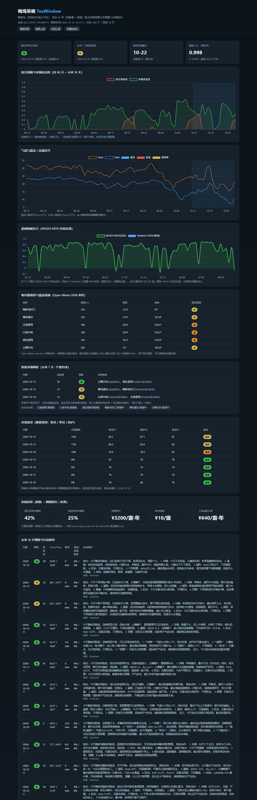

<!--
用法：本文为「PPT 路演稿」（逐页大纲 + 讲稿 + 备注）。
可用 Marp / VS Code（Marp 插件）直接导出为 PPTX/PDF；
或按每页标题与要点手动制作 PPT。
总时长建议：5 分钟主讲 + 2 分钟问答。
-->

# 梅坞采候 TeaWindow
## 梅家坞龙井「倒春寒 × 高温」复合风险预警与采摘窗口决策助手

AI4Climate 全球青年气候解决方案挑战赛 · 赛道 01 梅家坞气候智慧茶园

<!-- 开场：自我介绍 + 一句话定位 -->

---

## 1. 一句话
**把分散的气象与遥感信号，变成茶农看得懂、能执行的一句话：今天该采、该遮阳、该灌溉，还是该防冻。**

<!-- 备注：强调"可行动"，不是又一张气象图。 -->

---

## 2. 问题：真实的、具体的
- 梅家坞约 **70%** 茶园是**特早生、抗旱弱**的**龙井 43 号**。
- **春天怕倒春寒**：2010 年浙江冻害，损失约 **17 亿元**。
- **夏天怕高温干旱**：2020/2022 年西湖区约 **5000 亩**茶树灼伤。
- **2024 年杭州高温日 60 天**破纪录（8/3 达 41.9℃）。
- 风险叠加连阴雨/台风 → **复合风险**，信号分散、难判读。

<!-- 备注：数字即证据，体现"问题真实与气候价值"(20%)。 -->

---

## 3. 用户与痛点
- 用户：**梅家坞茶农、采茶队管理者、合作社**。
- 每天最想知道的三件事：
  1. 今天有没有风险？
  2. 是什么风险？
  3. 现在**该采，还是该防**？
- 现状：气象、遥感、土壤信号**碎片化**，靠经验判断。

<!-- 备注：明确"对象明确"(对象/受益方)。 -->

---

## 4. 方案总览
```
Open-Meteo 气象(历史+预报)     NASA GIBS / Sentinel-2 遥感
        │                                │
        ▼                                ▼
  农业气象指标引擎               植被活力(NDVI)
        └────────────┬──────────────────┘
                     ▼
        GBDT 复合风险识别 → 低/中/高/极高
                     ▼
        透明规则：采摘适宜度 + 最佳窗口
                     ▼
        DeepSeek/规则后备：茶农白话建议
                     ▼
        单页离线仪表盘（可运行 Demo）
```
<!-- 备注：强调"端到端闭环"，不是单点模型。 -->

---

## 5. AI 为什么必要（核心）
- 单一阈值（仅 Tmin≤2℃ 判霜冻）→ 只覆盖霜冻、误报高。
- 我们的**梯度提升树(GBDT)** 融合 **气温+湿度+水分亏缺+土壤+物候+交互项**。
- **2024–2025 留出年**：

| 指标 | TeaWindow GBDT | 单阈值基线 |
|---|---|---|
| AUC | **0.998** | 0.780 |
| F1 | **0.854** | 0.498 |

- AI 的价值：**捕捉复合交互**，并**前推至预报期**给出连续、可解释的风险。

<!-- 备注：对齐"AI 方案与技术有效性"(20%)，用对比说话。 -->

---

## 6. 现场演示（Demo）
1. **KPI 卡片**：今日风险 / 未来 7 天最高风险 / 推荐采摘窗口 / 模型效果。
2. **风险时间线**：红=复合风险度，绿=采摘适宜度；右侧灰色=预报期。
3. **气温信号**：蓝点=霜冻日，红点=高温日，黄三角=倒春寒。
4. **16 天预报表**：逐日风险 + 适宜度 + **DeepSeek 白话建议**。
- 全程**离线**、双击即开。



> 在线地址：实时服务 **https://teawindow.onrender.com** ｜ 静态页 **https://eric2007-sudo.github.io/TeaWindow/**（可现场扫码）

<!-- 备注：放仪表盘截图（submit/仪表盘截图.png）。 -->

---

## 7. 数据与遥感
- 气象：**Open-Meteo**（ERA5 历史 2015–2026，4301 天 + 16 天预报）。
- 遥感：**NASA GIBS MODIS NDVI**（近似反演）+ **Sentinel-2 STAC** 场景接入。
- LLM：**DeepSeek deepseek-chat** 生成茶农白话建议。
- **全部公开、免密钥、零数据成本**。

<!-- 备注：对齐"数据与 AI 说明"。 -->

---

## 8. 差异化（不重复、做增量）
| 维度 | 官方气象现状 | TeaWindow |
|---|---|---|
| 粒度 | 区域级 | **地块级** |
| 风险 | 以霜冻为主 | **倒春寒×高温×干旱×连阴雨复合** |
| 输出 | 要素/短信 | **可行动采摘窗口+养护建议** |
| 用户 | 部门 | **直接面向茶农** |
| 闭环 | 预警→短信 | **预警→行动→反馈→验证** |

<!-- 备注：主动说明与杭州市气象局现有能力的互补关系。 -->

---

## 8b. 从预测到决策（新颖点）
- **采摘调度**：产能约束下，未来 7 天把地块排到最优采摘日。
- **决策论建议**：用集合概率算"抢采 / 等待 / 防护"的**期望效用**。
- **反事实归因**：灌溉/遮阳使高温风险 **−18%**，覆盖/熏烟使霜冻风险 **−40%**。
- **智能问答**：口头问"明天该采哪块地"，DeepSeek 结合实时数据作答。
- **众包闭环**：茶农上报开采/灾情 → 自动复校 GDD 阈值（数据飞轮）。
- **价值闭环 + 天气指数保险**：预估损失/保费，客观指数自动赔付。

<!-- 备注：这是相对"同题作品"的核心差异化：预测→决策→归因→交互→闭环→变现。 -->

---

## 9. 落地与可持续
- **90 天验证计划**：回测(D1–20)→试点(D21–75)→校准(D76–90)。
- 目标：事件召回 ≥80%、误报 ≤20%、建议采纳 ≥60%、可用性 ≥4/5。
- **付费方**：合作社、茶企、数字农业服务商、气象/农险场景。
- 成本极低（纯 numpy，本地/边缘可跑）。

<!-- 备注：对齐"可实施性"(20%)+"市场可持续性"(15%)。 -->

---

## 10. 伦理与开放性
- 明确为**决策辅助**，**不替代**官方预警与农技指导。
- 诚实披露：模型为**弱标签监督**；遥感为**近似反演**。
- 数据公开、代码可复现、方法透明 → 可迁移到其他龙井产区。

<!-- 备注：对齐"扩展性、伦理与开放性"(10%)，主动示弱更可信。 -->

---

## 11. 收尾
**ONE PLACE · ONE CLIMATE PROBLEM · ONE AI SOLUTION**

梅坞采候，让 AI 走进真实茶园。

<!-- 备注：留 2 分钟问答。准备问题：与官方气象如何协作？数据标签如何获取？如何扩展到其他产区？ -->
